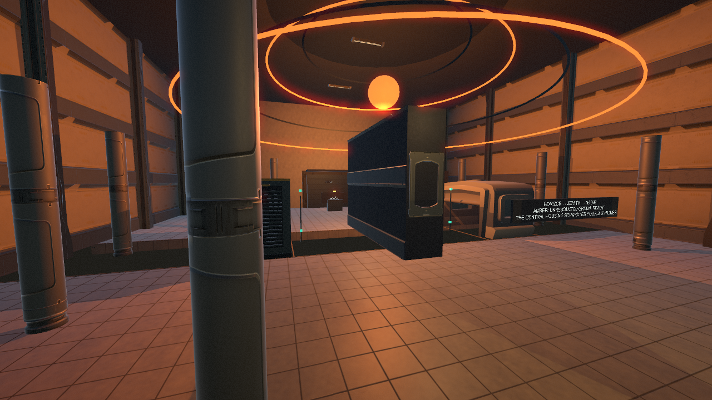
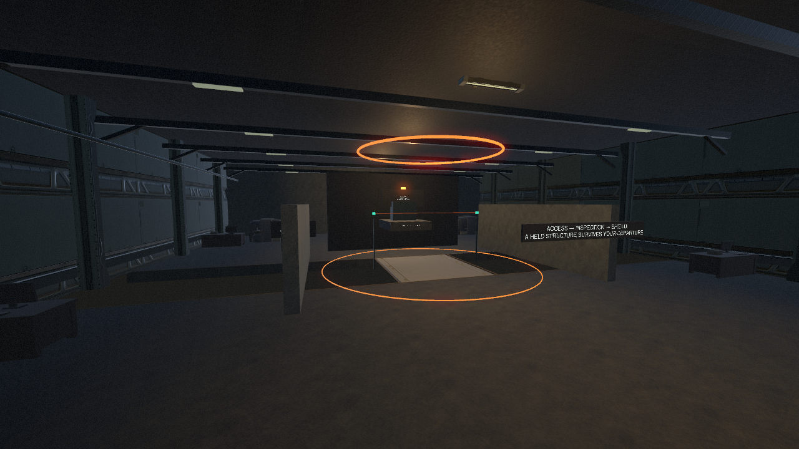

# The Unobserved

A small first-person puzzle game about an abandoned institution that changes when you stop observing it. Restore the departure line and find your way back to daylight.

**Unity 6 · C# · Windows · Single player · AI-assisted development**



## The game

Eight authored wings develop one idea: what you see remains stable, and what you leave behind may become something else. Preserve a crossing by watching it, anchor a structure before leaving it, expose a signal through an empty aperture, or use a tall structure to shield a beam. Later puzzles combine elevation, selective observation and two limited anchor channels.

The tone is liminal and uneasy rather than combat-driven horror. The project has a complete escape route, sparse original procedural audio, modeled environment art, two authored room transformations and 24 curated decorative locations that change identity or arrangement while unseen.

## Play

Download the Windows build from [Releases](https://github.com/MrSpiffy/the-unobserved/releases). Extract the entire ZIP and run `The Unobserved.exe`; keep the data and runtime folders beside it.

| Input | Action |
|---|---|
| WASD / arrows, mouse | Move and look |
| Space | Jump |
| F | Operate a control / collect instrument |
| E | Hold or release an aimed unstable structure after acquiring the instrument |
| R | Release all manual holds |
| Escape | Pause and settings |
| Backspace | Recover at the current wing entrance |

Settings include sensitivity, FOV and separate audio mixes. Falls preserve connected circuits. There is no disk-save system, combat, inventory or crafting.

## Engineering highlights

- **Conservative observation:** a centralized scheduler combines retained viewport bounds, cached renderer geometry and convex-occluder tests. Uncertain partial visibility keeps objects stable rather than risking a visible pop.
- **Controlled transitions:** visible-to-hidden edges drive bounded, nonrepeating state decks. Supporting structures and occupied transformation volumes have safety guards.
- **Independent art and collision:** five functional forms retain authored traversal geometry while imported architectural interpretations and selected late-game simplified forms provide appearance.
- **Physical puzzle conditions:** marked optical segments test clearance or shielding against actual world collision. Controls show outcomes, not named-form passwords. Persistent circuits allow anchor reuse.
- **Coherent environmental revisions:** complete authored floor regions commit one finish when safely unseen. Decorative variants are prepared once and toggled without per-prop Update loops.
- **Regression tooling:** an opt-in standalone harness checks progression, real CharacterController traversal, slow camera-edge sweeps, occlusion, placement envelopes, floor commits and the ending, and produces player-rendered review images.



## Run from source

1. Clone this repository. Imported assets and their Unity `.meta` files are included; the original download ZIPs are not needed.
2. Open with **Unity 6000.3.12f1**, including Windows build support.
3. Open `Assets/Scenes/TheUnobserved.unity` and press Play.
4. If regenerating scene defaults, use **Unobserved → Create or refresh authored scene**. This resets the generated scene/data to code-authored defaults.

The level is constructed at runtime from fixed authored coordinates; it is not a randomly generated maze.

```powershell
# Build Windows and optionally run the standalone regression harness.
./Tools/Build-Windows.ps1 -Verify
```

The script defaults to the editor version above; use `-UnityPath` for another installation path. Building requires a working local Unity installation/license. A licensed CI build is not configured.

## Project map

| Location | Responsibility |
|---|---|
| `Assets/Scripts/Core` | Observation, functional states, game flow and runtime verification |
| `Assets/Scripts/World` | Authored layouts, optical puzzle conditions, floor/decor revisions and soundscape |
| `Assets/Scripts/Player` | Movement, anchoring and interaction |
| `Assets/Editor` | Scene setup, asset preparation and player build |
| `Tools` | Reproducible surface/audio generation, asset extraction and build script |
| `Documentation` | Design audit, solution sequences, verification evidence and asset provenance |

## Design and evidence

- [Gameplay redesign and intended solutions](Documentation/GAMEPLAY_REDESIGN.md) — contains spoilers.
- [Verification and limitations](Documentation/VERIFICATION.md).
- [Observation and environmental memory](Documentation/OBSERVATION_POLISH.md).
- [Playtesting protocol](Documentation/PLAYTEST.md).
- [Third-party art credits](Documentation/THIRD_PARTY_ART.md).

Automated progression uses controlled player positioning and targeted movement checks. It is not evidence of a blind human playthrough, measured first-play duration or performance on low-end hardware. Conservative visibility may delay changes behind complex occluders. The game remains a small, stylized prototype under active playtesting.

## Authorship and asset provenance

This is an **AI-assisted development project**, developed through iterative direction, implementation and playtesting. Its value as a portfolio artifact is the inspectable design, code, testing and documented tradeoffs; it should not be represented as wholly handwritten implementation.

Models/textures from **Kenney Furniture Kit**, **Kenney Factory Kit**, and **Quaternius Modular SciFi MegaKit Standard FREE** are third-party CC0 assets, credited with their supplied licenses in `Assets/ThirdParty`. Project-specific audio and surface maps are generated by the included scripts. No blanket software license is granted here for the original project code; the included third-party licenses retain their own terms.
